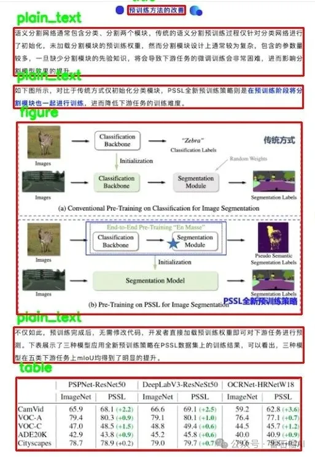
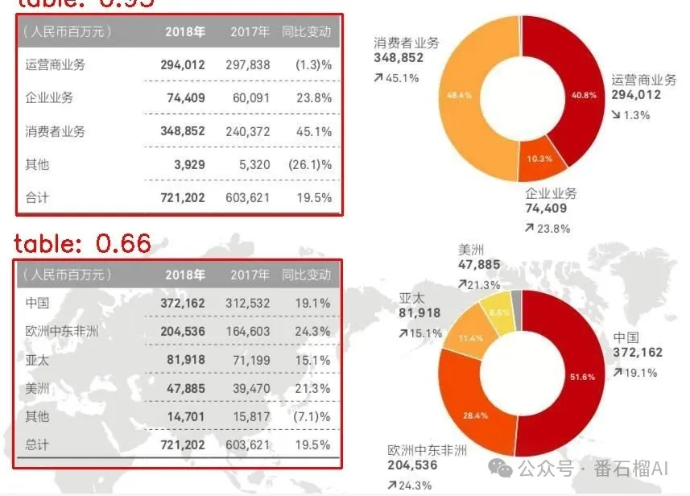
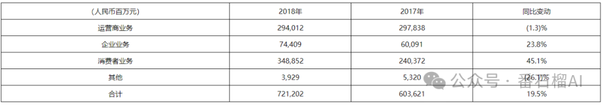

# JiaJiaOCR

[](README_CN.md)
[](https://github.com/jiangnanboy/JiaJiaOCR/stargazers)
[]()
[](LICENSE)
[]()
[]()

> **A pure-Java OCR engine** — general OCR, handwritten OCR, layout detection, table detection & recognition, and PDF recognition. Lightweight, cross-platform, and ready to use out of the box.

## ✨ Highlights

- ☕ **Pure Java** — no JNI/EXE/DLL, no Python runtime; a single JAR does it all.
- 🧠 **CPU-first inference** — **CPU is recommended**, no GPU/CUDA required, minimal deployment cost.
- 💻 **Cross-platform** — supports **x86_64 and ARM**, running on **Windows / Linux / macOS**.
- 🇨🇳 **Domestic IT (信创) support** — compatible with **some domestic operating systems** (Kylin, UOS, etc.) on x86_64 / ARM.
- ⚡ **Lazy loading** — models are loaded on demand, only the feature you use gets loaded.
- 📦 **Bundled models** — models ship inside the JAR; an external model directory is also supported via `-Djiajia.model.dir`.
- 🧵 **Thread-friendly** — a single instance can be safely shared for concurrent batch recognition.

## 🖥️ Platform Support

| Platform | Architecture | Status |
| --- | --- | --- |
| Windows | x86_64 | ✅ Supported |
| Linux | x86_64 | ✅ Supported |
| Linux | ARM64 (aarch64) | ✅ Supported (Raspberry Pi, ARM servers, etc.) |
| macOS | x86_64 / ARM64 | ✅ Supported |
| Domestic IT (Kylin, UOS, etc.) | x86_64 / ARM | ✅ Partially supported |

> Inference runs on **CPU** by default and does **not require a GPU**. See [ARM_SUPPORT.md](ARM_SUPPORT.md) for architecture details.

## 🧩 Features

| Feature | Description |
| --- | --- |
| 📝 General OCR | Mixed Chinese / English / digits / symbols recognition with text, confidence, and 8-point coordinates. |
| ✍️ Handwritten OCR | Optimized for Chinese handwriting; **92%+** accuracy on standard datasets. |
| 📋 Layout Detection | Detects titles, paragraphs, figures, tables, and returns coordinates. |
| 📐 Text Line Detection | Locates text-line positions only (no content recognition). |
| 📊 Table Detection | Locates table regions with confidence. |
| 🧾 Table Recognition | Parses table structure into **HTML** and structured **JSON** (rows & columns). |
| 📄 PDF Recognition | Converts multi-page PDFs to images and runs batch OCR. |
| ⏹️ Task Cancellation | Cancels long-running recognition tasks. |
| 🧵 Multi-threaded Batch | Concurrent batch processing on a shared instance. |

## ⚡ Performance

Reference timings on a **CPU** environment (**cold** = first call, includes model loading; **warm** = models loaded, inference only). Except for multi-threaded batch, each feature is measured on a **single image**; multi-threaded batch uses **3 concurrent threads**:

| Feature | Cold start | Warm (inference) |
| --- | --- | --- |
| General OCR | 928 ms | 426 ms |
| Handwritten OCR | 1516 ms | 989 ms |
| Layout detection | 1572 ms | 910 ms |
| Text line detection | 194 ms | 123 ms |
| Table detection | 748 ms | 478 ms |
| Table detection + recognition (one-step) | 1986 ms | 1362 ms |
| Multi-threaded batch (3 threads) | warm-up 686 ms | total 1411 ms |

PDF recognition (27-page sample): ~10.6s for PDF-to-image conversion, ~38.8s for OCR (~1.4s per page).

> Values are for reference only; actual timings vary by machine and image content.

## 🚀 Quick Start

### 1. Requirements

- Lite 1.0+ / Full 2.0.x: **JDK 8+**
- Full 2.1.0 / 2.2.0: **JDK 11+** (recommended)
- OS: Windows 10+, Linux x86_64, Linux ARM, domestic operating systems
- Build tool: Maven (recommended)

### 2. Dependencies

Add the core dependencies to your `pom.xml`:

```xml
<dependencies>
    <dependency>
        <groupId>com.microsoft.onnxruntime</groupId>
        <artifactId>onnxruntime</artifactId>
        <version>1.19.0</version>
    </dependency>
    <dependency>
        <groupId>org.openpnp</groupId>
        <artifactId>opencv</artifactId>
        <version>4.9.0-0</version>
    </dependency>
    <dependency>
        <groupId>org.apache.pdfbox</groupId>
        <artifactId>pdfbox</artifactId>
        <version>3.0.2</version>
    </dependency>
</dependencies>
```

> `pdfbox` is only needed for PDF recognition.

### 3. Build the JAR

[Releases](https://github.com/jiangnanboy/JiaJiaOCR/releases) provides a **source package (models included)**. Extract it and run the following from the project root:

```bash
mvn clean package -DskipTests
```

The built JAR is at `target/JiaJia-2.2.0.jar`; add it to your project's dependencies.

### 4. Models

Models are **bundled inside the JAR** (classpath `models/`) and work out of the box.

To use an **external model directory** (separate model distribution, hot-swap, etc.), set a system property:

```bash
java -Djiajia.model.dir=/path/to/models -jar yourapp.jar
```

The external directory must mirror the bundled layout:

```
models/
├── text_detection/det.onnx
├── direction_detection/cls.onnx
├── text_recognition/rec.onnx
├── text_recognition/dict.txt
├── handwriting_rec/rec.onnx
├── handwriting_rec/dict.txt
├── layout_analysis/layout.onnx
└── table_recognition/table_det.onnx
└── table_recognition/table_reg.onnx
```

### 5. Minimal Example

```java
import com.jiajia.common_object.*;
import com.jiajia.core.JiaJiaOCR;
import org.apache.commons.lang3.tuple.Pair;

import java.util.List;

public class QuickStart {
    public static void main(String[] args) throws Exception {
        // Create an instance (OpenCV loads automatically; models load on demand)
        try (JiaJiaOCR ocr = JiaJiaOCR.builder()) {
            List<Pair<Text, Box>> results = ocr.recognizeGeneralText("general.png");
            for (Pair<Text, Box> item : results) {
                System.out.println(item.getLeft().getText());
            }
        }
    }
}
```

## 📖 API Usage

> All examples use the `JiaJiaOCR` facade. Common imports:
> `import com.jiajia.common_object.*;`, `import com.jiajia.core.JiaJiaOCR;`, `import org.apache.commons.lang3.tuple.Pair;`.
> Every method accepts a `String path`, `Mat`, or `BufferedImage`; examples below use a path.

### 1. General OCR

```java
try (JiaJiaOCR ocr = JiaJiaOCR.builder()) {
    List<Pair<Text, Box>> results = ocr.recognizeGeneralText("general.png");
    for (Pair<Text, Box> item : results) {
        System.out.println(item.getLeft().getText());            // text
        System.out.println(item.getRight().getScore());          // confidence
        System.out.println(item.getRight().getLinePosition());   // 8-point coordinates
    }
}
```

### 2. Handwritten OCR

```java
try (JiaJiaOCR ocr = JiaJiaOCR.builder()) {
    List<Pair<Text, Box>> results = ocr.recognizeHandwrittenText("handwriting.jpg");
    for (Pair<Text, Box> item : results) {
        System.out.println(item.getLeft().getText());
    }
}
```

### 3. Layout Detection

```java
try (JiaJiaOCR ocr = JiaJiaOCR.builder()) {
    List<Layout> layouts = ocr.detectLayout("layout.png");
    for (Layout l : layouts) {
        System.out.println(l.getLabel() + ", confidence: " + l.getConfidence()); // type & confidence
        System.out.println(Arrays.toString(l.getBbox()));                          // bounding box
    }
}
```

### 4. Text Line Detection

```java
try (JiaJiaOCR ocr = JiaJiaOCR.builder()) {
    Boxes boxes = ocr.detectTextLines("general.png");
    for (Box box : boxes.getBoxes()) {
        System.out.println(Arrays.toString(box.getLinePosition()));                // 8-point coordinates
    }
}
```

### 5. Table Detection

```java
try (JiaJiaOCR ocr = JiaJiaOCR.builder()) {
    List<DetectionResult> tables = ocr.detectTables("table.png");
    for (DetectionResult t : tables) {
        System.out.println(t.getClassLabel() + ", confidence: " + t.getConfidence());
        System.out.println(t.getRect());                                           // table region
    }
}
```

### 6. Table Recognition (two steps: OCR + structure)

```java
try (JiaJiaOCR ocr = JiaJiaOCR.builder()) {
    // Step 1: run general OCR
    List<Pair<Text, Box>> ocrResults = ocr.recognizeGeneralText("table.png");
    // Step 2: recognize table structure
    TableResult table = ocr.recognizeTableFromOCR("table.png", ocrResults);
    System.out.println(table.getHtml());        // HTML result
    System.out.println(table.getTableJson());   // structured JSON (rows & columns)
}
```

### 7. One-step Table Detection & Recognition

```java
try (JiaJiaOCR ocr = JiaJiaOCR.builder()) {
    List<TableResult> tables = ocr.recognizeTables("table.png");
    for (TableResult t : tables) {
        System.out.println(t.getHtml());
        System.out.println(t.getTableJson());
    }
}
```

### 8. PDF Recognition

```java
try (JiaJiaOCR ocr = JiaJiaOCR.builder()) {
    List<String> pageImages = PdfConvert.convertPdfToImages("doc.pdf", "pdf_images");
    for (String img : pageImages) {
        List<Pair<Text, Box>> results = ocr.recognizeGeneralText(img);
        for (Pair<Text, Box> item : results) {
            System.out.println(item.getLeft().getText());
        }
    }
}
```

### 9. Task Cancellation & Multi-threaded Batch

```java
// Cancellation: pass a CancellationToken and call cancel() from another thread
CancellationToken token = new CancellationToken();
new Thread(token::cancel).start();
ocr.recognizeGeneralText("general.png", token);

// Multi-threaded batch: share a single instance (warm it up first)
JiaJiaOCR sharedOcr = JiaJiaOCR.builder();
sharedOcr.recognizeGeneralText("general.png");   // warm up: load models once
// then call sharedOcr.recognizeGeneralText(...) concurrently from multiple threads
```

> A complete runnable example is available at [src/test/java/JiaJiaOCRFullTest.java](src/test/java/JiaJiaOCRFullTest.java).

## 📦 Versions

| Version | Size | Core Features | JDK |
| --- | --- | --- | --- |
| 🔥 Lite (1.0+) | 21 MB+ | General OCR, PDF recognition | 8+ |
| ⚡ Full (2.0.x / 2.1.0 / 2.2.0) | 200 MB+ | General OCR + handwritten OCR + layout detection + table recognition + PDF recognition | 2.0.x: 8+; 2.1.0 / 2.2.0: 11+ |

**v2.2.0** (recommended) fully supports **x86_64 and ARM**, with domestic IT (信创) adaptation.

### Release Notes

- **v1.0.1** — Return empty string instead of `null` for blank English OCR results.
- **v1.0.2** — Add multi-page PDF text extraction.
- **v2.0.x** — Lazy model loading, handwritten OCR, layout detection, table detection & recognition, coordinate output, HTML table output.
- **v2.1.0** — Memory optimization, structured **JSON** table output, task cancellation, multi-threaded batch processing.
- **v2.2.0** — x86_64 & ARM support, domestic IT (信创) adaptation.

## 📊 Return Data

| Module | Return Type | Description |
| --- | --- | --- |
| General / Handwritten OCR | `List<Pair<Text, Box>>` | `Text`: content; `Box`: confidence + 8-point coordinates. |
| Layout detection | `List<Layout>` | label (title/paragraph/table ...), bbox, confidence. |
| Table detection | `List<DetectionResult>` | table rectangle, class, confidence. |
| Table recognition | `TableResult` | `getHtml()` + `getTableJson()` dual output, plus coordinates and elapsed time. |

## 🖼️ Demo

| General OCR | Handwritten OCR |
| --- | --- |
|  |  |

| Layout detection | Table detection | Table recognition |
| --- | --- | --- |
|  |  |  |

## 📞 Contact

- 🐙 GitHub: [jiangnanboy](https://github.com/jiangnanboy)
- 💬 QQ: 2229029156
- 📧 Email: 2229029156@qq.com

## ⭐ Support

If this project helps you, please leave a ⭐ Star. Your support keeps it improving! ❤️
